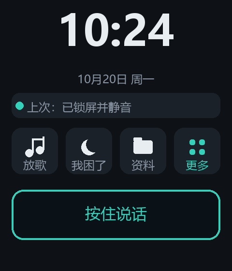

# firmware/ui —— 手表端界面（LVGL 8.2）

## 文件

| 文件 | 内容 | 行数量级 |
|---|---|---|
| `ui_theme.h` | **配色 + 布局常量（唯一事实来源）** | ~90 |
| `ui_main.h/.c` | 主界面 B 版：时钟/日期/最近结果/4 快捷格/大按钮 | ~200 |

预览图由 [`design/render_c_preview.py`](../../design/render_c_preview.py) **直接解析 `ui_theme.h`** 渲染出来，
所以改头文件 → 图跟着变，**图和代码永远一致**：



## 接到工程里的步骤

1. 把 `firmware/ui/` 整个目录加进 Keil 工程，头文件路径加上 `firmware/ui`
2. **确认 `lv_conf.h` 打开了大号数字字体**：
   ```c
   #define LV_FONT_MONTSERRAT_44   1   /* 时钟用；不开会编不过 */
   #define LV_FONT_MONTSERRAT_16   1
   #define LV_FONT_MONTSERRAT_12   1
   ```
3. **中文字库**：现在 `UI_FONT_CN12/CN16` 默认指向 Montserrat —— **能编过、但中文会是方块**。
   用 `lv_font_conv` 生成你自己的字库后，在 `lv_conf.h` 或工程里加：
   ```c
   #define UI_FONT_CN12   (&my_font_cn12)
   #define UI_FONT_CN16   (&my_font_cn16)
   ```
   （宏留了这个替换点，改完不用动 `ui_main.c`）
4. 主循环里：
   ```c
   lv_obj_t *scr = ui_main_create();
   lv_scr_load(scr);
   ui_main_set_time("10:24", "10月20日 周一");
   ui_main_set_result("上次：已锁屏并静音");
   ```

## 代码里替你做掉的几个坑

| 坑 | 处理方式 |
|---|---|
| LVGL 默认主题会给对象加内边距/边框，坐标全飘 | 每个对象都 `lv_obj_remove_style_all()` 后再设样式 |
| 图标用位图会吃 Flash | **全部用圆/圆角矩形图元拼**，零位图、零额外 RAM |
| 反复 create/delete 页面会打碎 128KB 堆 | 界面只创建一次，切页用 hidden 标志 |
| 屏幕尺寸写死 | 统一走 `UI_W/UI_H`，换屏只改头文件 |
| 时钟每秒刷新会整屏重绘 | 只更新 `lv_label` 文本，LVGL 自己算失效区 |

## 还没做的

- 锁屏 / 抽屉 / 录音 / 识别 / 确认 / 成功 / 失败 / 设置 七页
- 按键（KEY1/KEY2）与触摸事件绑定
- 时钟走时（RTC 每秒回调 `ui_main_set_time`）
